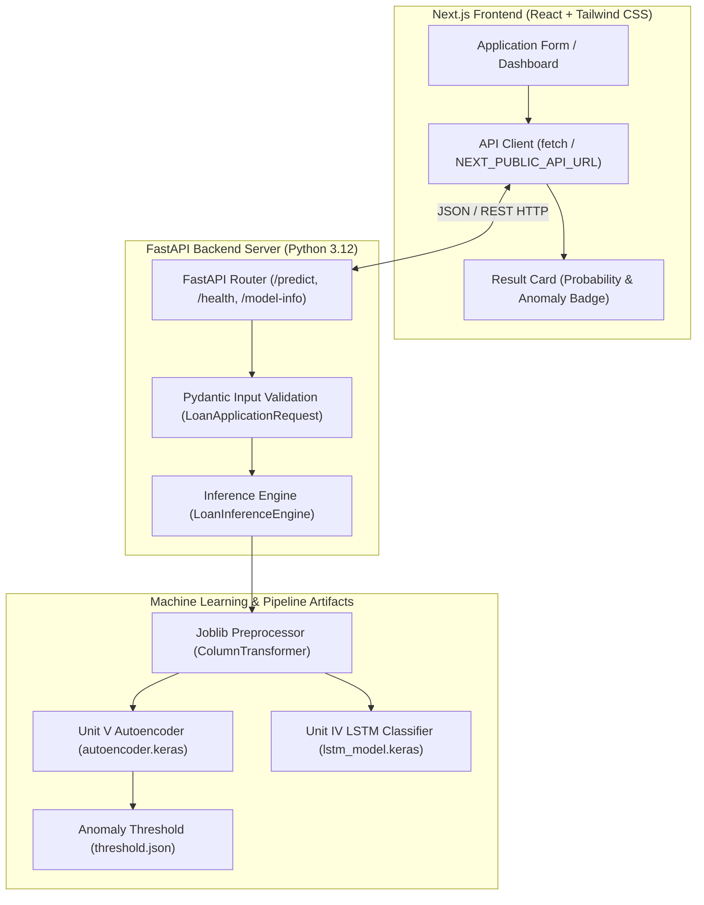
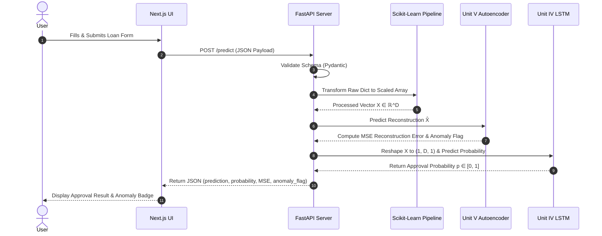

# System Architecture Documentation

This document describes the full-stack system architecture, data flow, and component interactions for the **Loan Approval Prediction Using Deep Learning** project.

---

## 1. High-Level Architecture Diagram



---

## 2. End-to-End Prediction Sequence



---

## 3. Directory Structure Summary

```
loan-approval-project/
├── backend/
│   ├── main.py               # FastAPI application & CORS
│   ├── schemas.py            # Pydantic validation models
│   ├── inference.py          # Inference wrapper engine
│   ├── preprocessing.py      # Feature engineering & ColumnTransformer
│   ├── train.py              # Main training orchestration script
│   ├── train_autoencoder.py  # Unit V Autoencoder trainer
│   ├── train_lstm.py         # Unit IV LSTM trainer
│   ├── evaluate.py           # Model evaluation & plot generator
│   ├── models/               # Saved model artifacts (*.keras, *.joblib, *.json)
│   └── tests/                # Pytest test suite
├── data/
│   └── loan_data.csv         # Kaggle Loan Prediction dataset
├── docs/
│   ├── architecture.md       # Architecture specification (this file)
│   ├── model.md              # Machine learning model documentation
│   ├── api.md                # REST API documentation
│   └── results/              # Evaluation plots & metrics
├── frontend/
│   ├── app/                  # Next.js App Router (pages & layout)
│   ├── components/           # React UI components (Form, ResultCard, etc.)
│   └── package.json
└── README.md
```
